# Connecting the extension

### Install

1. Open **Extension** and select **Download extension**.
2. Unzip the file.
3. Open chrome://extensions in Chrome or edge://extensions in Edge and turn on developer mode.
4. Choose **Load unpacked** and select the unzipped folder.
5. Pin the extension so it is one click away.

### Connect

1. In **Extension**, press **Connect extension**. A six digit code appears with a countdown.
2. Open the extension popup and enter the code, then press **Connect**.
3. Allow the site permission when the browser asks. The workspace then shows **Extension connected**.

### Several devices

- Press **Create 5 codes for several devices**. Each code works once, on one browser, and expires on its own timer.
- Use one code per browser or device.

### Duration, disconnecting, revoking

- A connection lasts 30 days. Connect again when it ends.
- To disconnect one browser, use the disconnect control in the extension popup.
- To cut off every connection, open **Manual pairing fallback** on **Extension** and press **Revoke my organization pairings**.

### Update and check the version

- To update, download the extension again, replace the folder and reload it on the extensions page.
- **Settings** (the gear button) in the extension shows the version it is running.

### Turning the extension on and off

- Open **Settings** with the gear button at the top right of the extension popup. **Extension on** is the first switch there. When it is off, the extension does not read any ticket and **Scan ticket** is hidden.
- **Scan automatically when I open it** is off by default. Leave it off to scan only when you press **Scan ticket**, or turn it on to scan the open ticket as soon as you open the extension.
- The switches are remembered in your browser. **Active browsers** on **Overview** counts browsers that used the extension in the last 14 days, not every code that was ever entered.

### Keeping documentation up to date

- New or changed articles reach the extension on their own: it checks your access and refreshes its copy every time you press **Scan ticket**, and when it is older than 15 minutes if you scan automatically.
- To refresh right away, open **Settings** in the extension and press **Sync documentation now**. It shows when it last synced.
- The footer of the extension shows your source names. With one source it shows the name, the article count and the sync time. With several it shows the number of sources and lists each name with its count; press **+N more** to see them all.
- When you have more than one source, each relevant article in a result carries a small tag with its source name.
- A short network problem does not disconnect you. Only a revoked or expired connection asks you to pair again.
