# Findings and CSV import

### Check a question here

- Open **Findings**, enter a subject and the customer question and press **Check documentation**.
- Set **Review finding** to **Confirmed gap** or **Dismissed / covered**.
- Press **Save current reviewed metadata** to store the review in your workspace. The question text is not saved.
- **Export reviewed metadata** downloads a CSV without the question or ticket content.

### Historical ticket CSV

- Open **Historical ticket CSV** and choose a UTF-8 file, up to 20 MB and 100,000 rows.
- Map the columns. ID, subject and description are required.
- Press **Import and redact**. Emails and similar details are replaced before anything is shown.
- Use **Group and check imported tickets (up to 1,000)** for a bulk check. Imported tickets live in the tab only.
