# Getting started

Gap Finder compares what customers ask in Zendesk tickets with your public documentation. It runs in two parts: this workspace (**Overview**, **Documentation**, **Extension**) and a Chrome or Edge extension that reads the open ticket.

### The three steps

1. **Index your documentation.** Open **Documentation**, enter your documentation homepage and press **Index documentation**.
2. **Connect the extension.** Open **Extension**, download and install it, then press **Connect extension** and type the code into the extension.
3. **Scan a ticket.** Open a Zendesk ticket, click the extension and press **Scan ticket**.

The setup card on **Overview** tracks steps 1 and 2 and disappears when both are done. Select **Show setup guide** in the sidebar to bring it back.

You can also use **Documentation** and **Findings** without an account: choose **Continue without an account** on the sign-in page. Local checks stay in the tab and nothing is saved.
