# Glossary and FAQ

### Glossary

- **Indexing:** reading your public documentation so it can be searched.
- **Source:** a documentation site or document in your workspace.
- **Match score:** a measure of word overlap between a ticket and an article.
- **Word stem:** the shared core of word forms, so installing and installation match.
- **Vocabulary:** owner-defined groups of words that mean the same.
- **Detection quality:** how often the article a staff reply linked was in the extension's top 3 (counts only, opt-in).
- **Potential gap:** a need with weak or no coverage that needs a human decision.
- **Reviewed metadata:** the review state you save for a finding, without question text.
- **One-time code:** a six digit code that links one browser to the workspace.

### FAQ

- **Does it use AI?** No. Matching is rule-based text retrieval.
- **Is ticket text uploaded?** No.
- **Does it work offline?** The app shell does. Indexing and account actions need a connection.
- **Can I use several workspaces?** Yes. Use the workspace switcher in the top bar.
