# Indexing documentation

### Add a site

- Open **Documentation**, enter a **Name** for the source (for example, "Example product public documentation") and the **Documentation URL** of your public documentation, then press **Add and index**.
- Wait for the progress text. The button shows **Indexing…** while it works.
- When it finishes you see **Documentation ready** and the number of articles.

### Name sources, add more and refresh

- Each documentation site is a source with a name you choose. Click a name to rename it: press Enter to save or Esc to cancel.
- Press **+ Add documentation source**, enter a name and another address, then press **Add and index**. Articles from your other sources are kept. Only one source is indexed at a time, so wait for the progress text to finish first.
- Press **Refresh** on a source to index it again. Its card shows the article count and when it was last indexed.
- Sources indexed before names existed show their web address as the name until you rename them.
- Only owners can add, rename, refresh or remove sources. Members see the list.

### Limits and skipped pages

- Indexing is bounded. It stops at fixed page and size limits and only fetches public, safe addresses.
- If the site is larger than the limits the status says **Partial coverage**. Some pages may be missing.
- Linked pages that redirect or are not found are skipped and counted in the status. This is normally harmless.

### Stop or continue

- Open **Indexing options** to **Resume indexing** after an interruption or **Cancel indexing**.
- A cancelled or failed run leaves your earlier documentation unchanged.

### Removing an indexed site

- Open **Documentation**. Each source card has a **Remove** button (owners only).
- Removing a source deletes its name and its indexed articles from the workspace. Other sites and articles you added by hand stay. You can index the site again later.
- Saved findings keep their text but lose the link to the removed articles.

### Cleaner articles

- Indexing drops menus, footers, cookie banners and sidebars, removes the site name from titles, keeps headings so they count more in matching, and skips duplicate articles (same title or same text), keeping the shortest address.
- Articles you indexed earlier keep their old text. Press **Refresh** on each source to benefit.
