# How matching works

Matching is deterministic word comparison that runs in your browser. No AI, language model or paid service is involved, and the same ticket always gives the same result.

### What it does

- **Word forms:** words are reduced to a stem, so install, installing and installation count as the same word, as do cache and caches. Words under four letters and words with digits are left alone. The chips still show the words as written.
- **Ranking:** articles are ranked with the standard BM25 formula. Words in the title count three times, words in headings twice, and two neighbouring words found next to each other earn a small bonus.
- **Vocabulary:** owners can list words that mean the same, such as slow, speed, performance and loading. A match through a synonym counts about 60% of an exact match.
- **Ticket type:** billing, account, cancellation, feature request, how-to, problem report or other, from simple English and French wording rules.

### Vocabulary

- Open **Documentation** and find the **Vocabulary** card. Type words separated by commas and press **Add group**.
- A group has 2 to 12 words, letters only. A word can belong to one group only, and a workspace can have up to 200 groups.
- Only owners change the list; members can read it. Browsers receive it with the other rules on their next sync, and it is never sent with a ticket.

### Limits

- A high score means shared wording, not a correct answer. Different wording without a synonym still looks like a gap.
- Results are hedged on purpose. Treat every item as a lead to review.
