# Privacy and security

- **No AI.** Matching, ticket types and ranking are fixed rules. Nothing readable is sent to any AI or third-party service.
- **Ticket text never leaves your browser.** It is read, matched and discarded there.
- **Suggestions are the one exception, and only when you press a button.** The extension sends a few filtered key words (lowercase letters only, no names, numbers, emails or links), a one-way fingerprint of them, the closest article and your vote. It also sends the ticket number and your Zendesk subdomain so a reviewer can open the ticket. It never sends the ticket text, subject, names or sentences.
- **Opt-in learning sends numbers or key words only.** If an owner turns on **Measure detection quality**, the extension sends whole-number counts per day. If an owner turns on **Learn from articles staff link**, it can send up to 8 filtered key words and the address of an article that is already in your index. Neither sends text, subjects, names, ticket numbers or the links in staff replies.
- **Staff reply links stay local.** The extension reads links in staff replies in your browser to compare them with your index. They are not stored.
- Those suggestions are shared with the workspace. The owner can turn collection off in **Suggestions**.
- The extension gets a **read-only** copy of the documentation you may see. It cannot change anything.
- Connections are limited to your workspace and expire after 30 days. You can revoke them at any time.
- The server stores your documentation index, members, settings and reviewed metadata such as a review state. It does not store ticket content.
- The extension asks only for the Zendesk and workspace sites it needs, and only reads the open ticket.
- **Sign out and clear local data** in **Settings** removes what this tab holds.
