# Scanning a ticket

### How to scan

1. Open a ticket in Zendesk and wait for it to load.
2. Click the extension.
3. Press **Scan ticket**.

### What is matched

- Only customer messages in the open ticket and its subject are matched. Agent replies and internal notes are not matched. Signatures, mail footers, quoted replies and phone or address lines are removed first, and later customer messages count a little more.
- Only what is loaded on screen. If the conversation is long, scroll to load earlier messages and scan again.
- Matching is deterministic text comparison against the documentation copy in your browser. No AI service is involved.

### Reading the results

- The coloured banner at the top is the verdict. It uses the same green, yellow, red and gray as the toolbar icon, with the number of relevant articles, potential gaps and articles checked.
- In a narrow popup the lists become three tabs, **Docs**, **Gaps** and **Ideas**. Use the arrow keys to move between them.
- Each article has **Open article** and **Copy link**. Select its passage to read more.
- **Relevant documentation** lists articles whose words overlap with the question.
- **Potential gaps** lists needs that have weak or no coverage.
- **Suggested improvements** lists wording that could be added to an article.

Each potential gap has two buttons, **Real gap** and **Not a gap**, with a line that shows exactly what will be sent. Nothing is sent until you press one. See **Training the tool**.

Results are hedged on purpose. A score shows word overlap, not proof that an article answers the question or that a gap exists. Read the article and decide.

### Short, non-English and billing tickets

- Very short messages give little to match. Expect fewer or weaker results.
- When a message repeats itself in two languages (for example French, a line, then English), the English part is analysed and the results say so.
- Billing, account and cancellation questions are recognised and never produce gap suggestions. Feature requests show **Looks like a feature request, not a documentation gap** unless an article clearly matches.
- The popup shows the detected ticket type under the ticket name, such as **How-to question** or **Problem report**.

If a staff reply in the ticket links one of your indexed articles, the extension reads those links in your browser to check whether it had listed that article. The links are not stored. They are shared only if the owner turned on a learning setting described in **Training the tool**.
