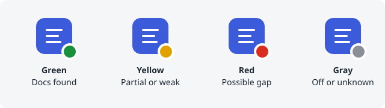

# Status icon

The extension can show the result of a ticket on its toolbar icon, so you see it without opening the popup. Turn on **Show status on the toolbar icon** in the popup and allow access to Zendesk when the browser asks.

### What the colours mean

- **Green** (badge **OK**): relevant documentation was found and no potential gap.
- **Yellow** (badge **!**): documentation was found but there are potential gaps, or the matches are weak.
- **Red** (badge **GAP**): no relevant documentation and at least one potential gap.
- **Gray**: off, not a ticket page, still scanning, no clear question found, a billing, account or cancellation request, a feature request, or the ticket could not be read.

Hover over the icon to read the same result as text. A colour is a lead to review, not proof of a gap.

### Privacy

- The scan runs in your browser on the ticket you have open. Ticket text is not stored and is not sent anywhere.
- Turn the switch off at any time to clear every icon and badge. **Extension on** must also be on.
