# Team and permissions

- **Owners** manage sources, members, invitations and **Settings**.
- **Members** use the documentation they are allowed to see.
- To invite someone, open **Team**, enter their Google account email and press **Create invitation**. No email is sent. Share the sign-in link yourself. Invitations expire after seven days.
- Restricted sources are visible to owners and to members who were granted them. Save documentation only if you are authorized to share it.
- Use **New organization** to create a separate workspace. The workspace switcher in the top bar appears when you belong to more than one.
