# Training the tool

Agents can tell the tool when a potential gap is real or a false positive. The workspace owner reviews these in **Suggestions**, and the decisions change future scans in every connected browser.

### For agents

1. Scan a ticket in the extension.
2. Under **Potential documentation gaps**, read the line that starts with **Sending**. It lists the exact words that will be sent.
3. Press **Real gap** or **Not a gap**. The card then shows **Sent**.

### For the owner

- Open **Suggestions**. Each card shows the key words, the closest article and how many people voted each way.
- **Approve as a gap** moves it to **Approved gaps**, which you can export as CSV.
- **Dismiss as false positive** hides matching gaps in the extension from the next scan.
- **An article covers this** lets you pick an indexed article. Matching tickets then show that article under **Relevant documentation**.
- Use **Undo** to reopen any decision.

### Turning it off

Owners can switch off **Collect suggestions from the extension** at the bottom of **Suggestions**. The extension then shows an error when someone presses a button.

Reconnect or rescan to receive new decisions. The extension must be version 0.4.0 or later.

### Deleting suggestions

- Owners can press **Delete** on any suggestion, in any list. Deleting asks for confirmation.
- Deleting a dismissed or covered suggestion also removes what the tool learned from it.
- If agents report the same gap again later, it comes back as a new open suggestion.

### Merged suggestions

- Suggestions with almost the same key words and the same closest article appear as one card, with **Also reported as** variants. Votes and distinct tickets are combined.
- The list is ordered by distinct tickets, then distinct reporters, then recency. **Open suggestions** on the overview counts cards.
- A decision on a card applies to every suggestion merged into it.

### Learning from your team (owner opt-in)

Two settings on **Suggestions**, both off by default and changed by owners only. Ticket text never leaves the browser.

- **Measure detection quality (counts only):** when a staff reply links one of your indexed articles, the extension checks locally whether that article was in its top 3 and sends only whole numbers per day: tickets scanned, tickets with a linked article, top 1, top 3 and misses. **Overview** then shows **Detection quality**, for example the share of such tickets where the linked article was in the top 3. It measures how often matching finds the article your team chose, not whether a suggestion is correct.
- **Learn from articles staff link:** when staff link an indexed article that the extension did not list, it adds one suggestion made of up to 8 filtered key words and that article, marked **Staff linked this article for these key terms**. You decide with **An article covers this**, which teaches the matcher. No ticket text, names or ticket numbers are sent.
- Only links to articles already in your index are used; other links are ignored and never sent. The extension must be version 0.6.0 or later.
