# Troubleshooting

### The code was rejected

- Codes work once and expire. Press **Connect extension** for a new one and type it without delay.
- Check you are in the same workspace you signed in to.

### No articles after indexing

- Check the address opens without signing in. Only public pages are indexed.
- Press **Resume indexing**, or index again and read the status text.

### Nothing found for a ticket

- Reload the documentation in the extension and scan again.
- Short or non-English messages match less. See **Scanning a ticket**.

### The scan says to open a ticket

- Open a single ticket tab and wait until the conversation loads, then scan again.

### The extension is out of date

- Download the extension again, replace the folder and reload it. **Settings** in the extension shows the version.
